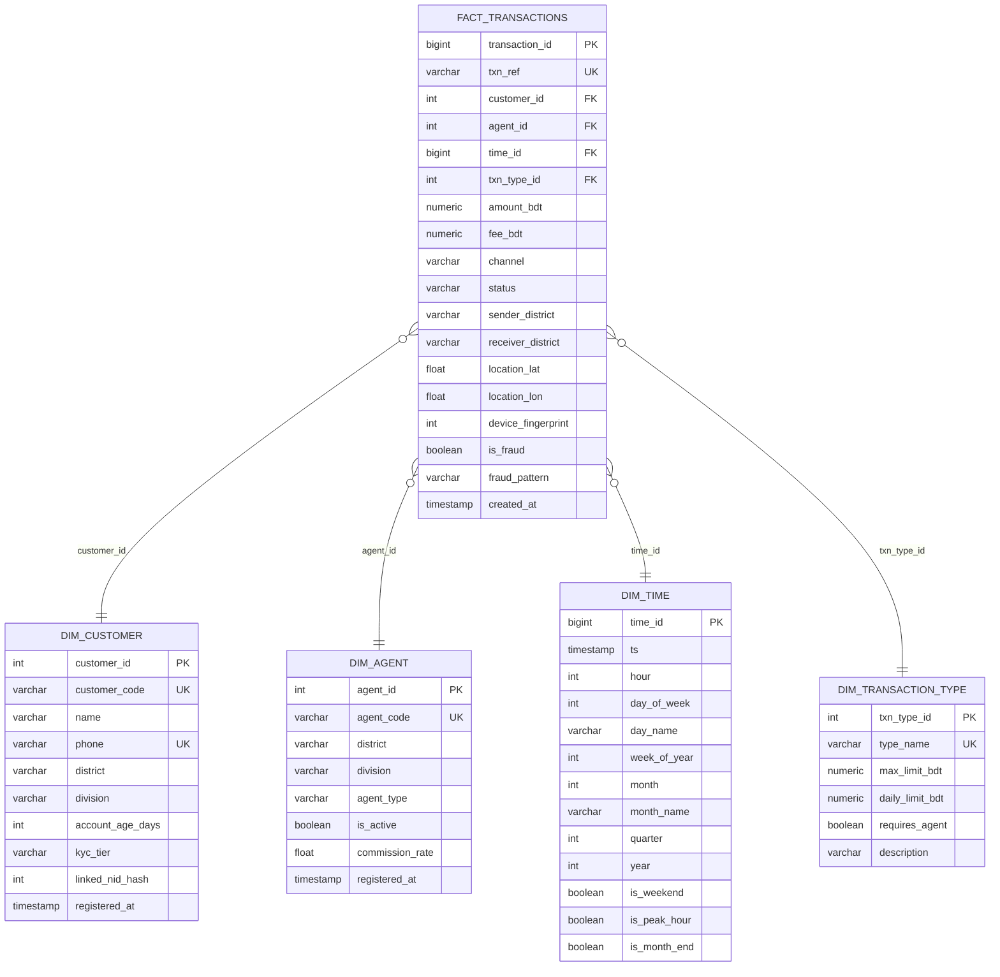

# Data Schema — Bangladesh MFS Fraud Detection

> **Synthetic Data Notice:** All data used in this project is **synthetically generated** using
> Python (Faker + NumPy). No real bKash, Nagad, or Rocket transaction data is used.
> Distributions are calibrated to publicly available Bangladesh MFS market reports (2022-2024).

---

## 1. Star Schema Overview

---

## 2. Table Definitions

### 2.1 FACT_TRANSACTIONS

| Column              | Type          | Description                                               |
|---------------------|---------------|-----------------------------------------------------------|
| transaction_id      | BIGINT PK     | Surrogate key                                             |
| txn_ref             | VARCHAR(20)   | Human-readable ref (e.g., TXN20240315001234)              |
| customer_id         | INT FK        | References DIM_CUSTOMER                                   |
| agent_id            | INT FK        | References DIM_AGENT (NULL for app-to-app)                |
| time_id             | BIGINT FK     | References DIM_TIME                                       |
| txn_type_id         | INT FK        | References DIM_TRANSACTION_TYPE                           |
| amount_bdt          | NUMERIC(12,2) | Transaction amount in BDT                                 |
| fee_bdt             | NUMERIC(8,2)  | Fee charged (0 for some types)                            |
| channel             | VARCHAR(20)   | app / ussd / agent                                        |
| status              | VARCHAR(20)   | success / failed / reversed                               |
| sender_district     | VARCHAR(50)   | Origin district                                           |
| receiver_district   | VARCHAR(50)   | Destination district                                      |
| location_lat        | FLOAT         | Approximate latitude                                      |
| location_lon        | FLOAT         | Approximate longitude                                     |
| device_fingerprint  | INT           | Hashed device ID (NULL for agent/USSD)                    |
| is_fraud            | BOOLEAN       | Ground truth fraud label                                  |
| fraud_pattern       | VARCHAR(50)   | NULL or pattern name (see Section 3)                      |
| created_at          | TIMESTAMP     | Row insertion time                                        |

### 2.2 DIM_CUSTOMER

| Column            | Type          | Description                                              |
|-------------------|---------------|----------------------------------------------------------|
| customer_id       | INT PK        | Surrogate key                                            |
| customer_code     | VARCHAR(15)   | e.g., CUST-00001                                         |
| name              | VARCHAR(100)  | Bangladeshi full name (synthetic)                        |
| phone             | VARCHAR(15)   | 01XXXXXXXXX format                                       |
| district          | VARCHAR(50)   | One of 64 Bangladesh districts                           |
| division          | VARCHAR(30)   | One of 8 divisions                                       |
| account_age_days  | INT           | Days since account opening                               |
| kyc_tier          | VARCHAR(10)   | tier1 (500/day) / tier2 (30K/day) / tier3 (200K/day)    |
| linked_nid_hash   | INT           | Hash of NID number                                       |
| registered_at     | TIMESTAMP     | Account registration timestamp                           |

### 2.3 DIM_AGENT

| Column           | Type          | Description                                               |
|------------------|---------------|-----------------------------------------------------------|
| agent_id         | INT PK        | Surrogate key                                             |
| agent_code       | VARCHAR(15)   | e.g., AGT-00001                                           |
| district         | VARCHAR(50)   | Agent location district                                   |
| division         | VARCHAR(30)   | Agent location division                                   |
| agent_type       | VARCHAR(20)   | retailer / super_agent / distributor                      |
| is_active        | BOOLEAN       | Whether agent is currently active                         |
| commission_rate  | FLOAT         | Commission % per transaction                              |
| registered_at    | TIMESTAMP     | Agent registration timestamp                             |

### 2.4 DIM_TIME

| Column        | Type         | Description                                                |
|---------------|--------------|------------------------------------------------------------|
| time_id       | BIGINT PK    | YYYYMMDDHHmmss format integer                              |
| ts            | TIMESTAMP    | Full timestamp                                             |
| hour          | INT          | 0-23                                                       |
| day_of_week   | INT          | 0=Monday to 6=Sunday                                       |
| day_name      | VARCHAR(10)  | Monday...Sunday                                            |
| week_of_year  | INT          | ISO week number                                            |
| month         | INT          | 1-12                                                       |
| month_name    | VARCHAR(10)  | January...December                                         |
| quarter       | INT          | 1-4                                                        |
| year          | INT          | e.g., 2024                                                 |
| is_weekend    | BOOLEAN      | True if Friday or Saturday (Bangladesh weekend)            |
| is_peak_hour  | BOOLEAN      | True if hour in 8-13 or 17-20                              |
| is_month_end  | BOOLEAN      | True if day in last 3 days of month                        |

### 2.5 DIM_TRANSACTION_TYPE

| Column          | Type          | Description                                              |
|-----------------|---------------|----------------------------------------------------------|
| txn_type_id     | INT PK        | Surrogate key                                            |
| type_name       | VARCHAR(30)   | send_money / cash_in / cash_out / payment / add_money    |
| max_limit_bdt   | NUMERIC(10,2) | Per-transaction ceiling (BFIU regulation)                |
| daily_limit_bdt | NUMERIC(12,2) | Daily ceiling                                            |
| requires_agent  | BOOLEAN       | Whether an agent must be involved                        |
| description     | TEXT          | Human-readable description                               |

---

## 3. Five Fraud Patterns

> All 5 patterns are synthetically injected. Labels in is_fraud=TRUE and fraud_pattern column.

### Pattern 1 — OTP/SIM-Swap Scam (otp_sim_swap)

**Description:** Fraudster takes over victim SIM via social engineering or SIM swap at telco.
Quickly drains wallet via cash_out to pre-registered agent in a different district.

**Signals:**
- cash_out within 5-30 minutes of account login from new device (device_fingerprint mismatch)
- Receiver district different from customer home district
- Amount near daily limit (threshold pressure)
- Unusual hour (midnight to 5am)

**Volume:** ~0.8% of all transactions

---

### Pattern 2 — Mule Account Chain (mule_chain)

**Description:** Stolen funds pass through 3-5 mule accounts rapidly (A to B to C to D)
before final cash-out, making tracing difficult.

**Signals:**
- Same amount forwarded across 3+ accounts within 10 minutes
- Each hop is send_money; final hop is cash_out
- Accounts in chain are all account_age_days < 30 (newly created mules)
- Velocity: customer makes >5 transactions in 1 hour

**Volume:** ~0.6% of all transactions (appears as clusters)

---

### Pattern 3 — Cash-Out Ring / Agent Velocity Spike (cashout_ring)

**Description:** Compromised or colluding agent processes unusually high volume of
cash_out transactions within a short window serving multiple different customers.

**Signals:**
- Single agent_id processes >20 cash_out transactions within 1 hour
- Amounts varied but all below single-transaction reporting threshold
- Customer accounts are newly created or dormant
- Agent in low-traffic district shows urban-level volume

**Volume:** ~0.5% of transactions

---

### Pattern 4 — Structuring / Smurfing (structuring)

**Description:** Large sums split into multiple just-below-threshold transactions
to avoid BFIU regulatory reporting (threshold: BDT 50,000 per MFS transaction).

**Signals:**
- Multiple transactions from same customer to same receiver within 24 hours
- Each transaction amount in range 45,000-49,999 BDT
- Total daily sum would exceed threshold if combined
- Often uses mix of send_money and payment types

**Volume:** ~0.4% of transactions

---

### Pattern 5 — Impossible Geography / Location Velocity (impossible_geo)

**Description:** Two transactions from same account originate from geographically
impossible locations in short time window (e.g., Chittagong and Sylhet within 10 minutes).

**Signals:**
- Two consecutive transactions from same customer_id with geo-distance > 100 km
- Time between transactions < 30 minutes
- Calculated travel speed > 200 km/h
- Channel is app (location data available)

**Volume:** ~0.3% of transactions

---

## 4. Data Generation Notes

| Parameter              | Value                                      |
|------------------------|--------------------------------------------|
| Total rows             | 50,000+ transactions                       |
| Date range             | 2024-01-01 to 2024-12-31 (full year)       |
| Fraud rate             | ~2.6% (combined all patterns)              |
| Customers              | ~5,000 unique                              |
| Agents                 | ~500 unique                                |
| Seed                   | Configurable via .env DATA_SEED            |
| Currency               | BDT (Bangladeshi Taka)                     |
| Amount range (legit)   | 10 to 30,000 BDT (lognormal distribution)  |
| Amount range (fraud)   | Pattern-specific (see Section 3)           |
| Primary reference      | Bangladesh Bank MFS report Q4 2023         |

---

*Last updated: Task 1.1 - Phase 1*
